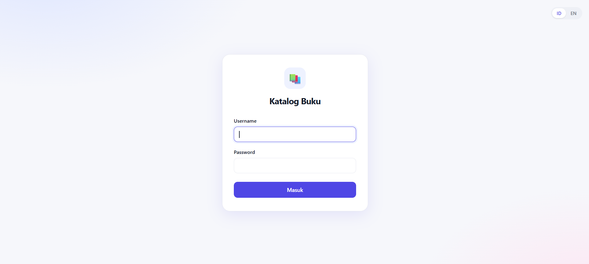
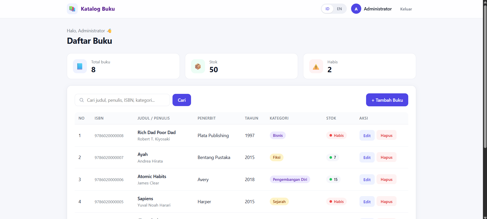
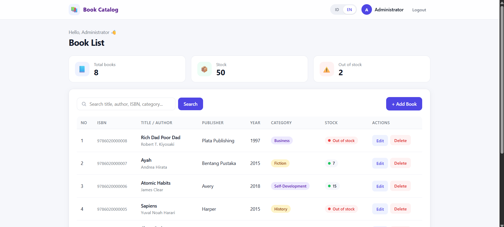
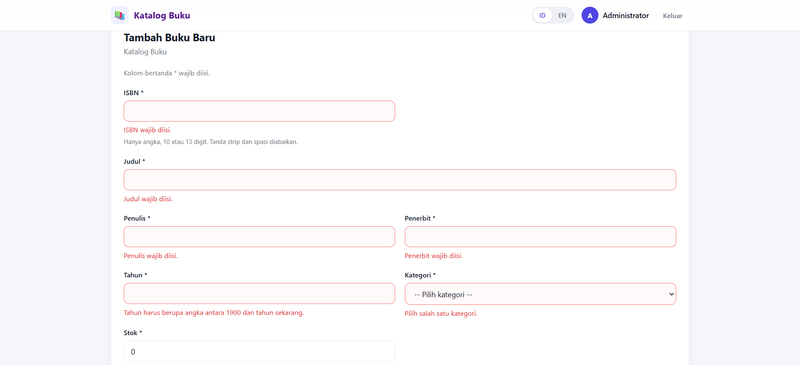

# 📚 Katalog Buku

Sistem Informasi Manajemen Data Sederhana untuk mengelola katalog buku, dibuat dengan **PHP murni** dan **MySQL**. Aplikasi dilindungi sistem login berbasis session dan mendukung dua bahasa antarmuka (Indonesia dan Inggris).

## Fitur

- **Login/Logout** dengan `$_SESSION`, `password_hash()`, dan `password_verify()`
- **Dual bahasa (ID/EN)** yang disimpan di `$_SESSION` sehingga konsisten antarhalaman
- **CRUD lengkap:** tambah, lihat, ubah, dan hapus data buku
- **Pencarian** berdasarkan judul, penulis, ISBN, dan kategori
- **Validasi form** dengan `if-else` dan `switch`
- **Sanitasi input** dengan `trim()`, `filter_var()`, `preg_replace()`, dan `htmlspecialchars()`
- **Prepared statement** pada semua query (aman dari SQL injection)
- **Pesan flash** dua bahasa dan pola Post/Redirect/Get
- **Tampilan modern dan responsif:** kartu statistik, badge kategori, indikator stok, dan tabel yang berubah menjadi kartu di layar HP

## Teknologi

- PHP 8 (tanpa framework)
- MySQL / MariaDB (ekstensi `mysqli`)
- HTML dan CSS
- XAMPP (Apache + MySQL)

## Akun Login Default

| Username | Password   |
|----------|------------|
| `admin`  | `admin123` |

## Cara Instalasi

1. Pasang **XAMPP**, lalu jalankan **Apache** dan **MySQL** dari XAMPP Control Panel.
2. Salin folder proyek ini ke `C:\xampp\htdocs\` sehingga menjadi `C:\xampp\htdocs\katalog-buku\`.
3. Buka `http://localhost/phpmyadmin`, klik tab **Import**, pilih file `database/katalog_buku.sql`, lalu klik **Import**. Database `katalog_buku` akan dibuat otomatis beserta datanya.
4. Cek `config/database.php`. Pengaturan bawaan XAMPP adalah user `root` dengan password kosong. Sesuaikan jika berbeda.
5. Buka `http://localhost/katalog-buku/` di browser, lalu login dengan akun di atas.

## Struktur Folder

```
katalog-buku/
├── config/
│   └── database.php        # koneksi MySQL
├── includes/
│   ├── auth.php            # penjaga halaman (cek session login)
│   ├── lang.php            # pemuat bahasa + fungsi t()
│   ├── lang_switcher.php   # tombol ID | EN
│   ├── helpers.php         # kategori, pesan flash, pesan error field
│   ├── header.php          # navbar + pembuka halaman
│   ├── footer.php          # penutup halaman
│   └── book_form.php       # form tambah/edit (dipakai ulang)
├── lang/
│   ├── id.php              # teks Bahasa Indonesia
│   └── en.php              # teks Bahasa Inggris
├── assets/css/style.css
├── database/katalog_buku.sql
├── screenshots/            # tangkapan layar aplikasi
├── login.php               # halaman login
├── logout.php
├── set_lang.php            # simpan pilihan bahasa ke session
├── index.php               # READ (tabel + pencarian)
├── create.php              # CREATE
├── edit.php                # UPDATE
├── delete.php              # DELETE
└── README.md
```

## Pemetaan ke Spesifikasi Tugas

| Syarat | Implementasi |
|---|---|
| Form dengan metode POST | `login.php`, `create.php`, `edit.php`, `delete.php` |
| Validasi `if-else` / `switch` | `create.php` dan `edit.php` |
| Sanitasi input | `trim()`, `filter_var()`, `preg_replace()`, `htmlspecialchars()` |
| Koneksi database | `config/database.php` |
| Create / Read / Update / Delete | `create.php` / `index.php` / `edit.php` / `delete.php` |
| Login dengan `$_SESSION` | `login.php`, `includes/auth.php` |
| Dual bahasa di `$_SESSION` | `includes/lang.php`, `set_lang.php`, `lang/*.php` |

## Screenshot

### Login


### Daftar Buku (Indonesia)


### Daftar Buku (English)


### Validasi Form


## Pembuat

M Fahriza Pratama - 10124033
